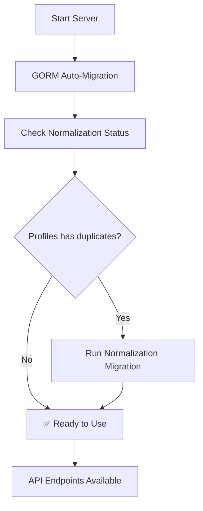

# Database Migration Guide

## Overview

This guide explains how to properly migrate the database to the new normalized schema for users and profiles tables.

## 🔄 Migration Steps

### 1. **Automatic GORM Migrations**

The system automatically handles basic table creation and updates using GORM auto-migration:

```bash
# Start the server - this will run auto-migrations
go run cmd/server/main.go
```

### 2. **Manual Schema Normalization**

For the users and profiles normalization, you need to run a specific migration:

```bash
# Apply normalization (remove duplicate fields)
go run cmd/migrate-users-profiles/main.go

# Rollback if needed
go run cmd/migrate-users-profiles/main.go rollback
```

## 📋 Migration Files

### **Auto-Migration Models**
- `models.User` - Authentication data only
- `models.Profile` - Personal info only (no duplicate fields)
- `models.Address` - User addresses
- `models.Product` - Product information
- `models.Image` - Product images
- `models.Inventory` - Product inventory
- `models.Order` - Order information
- `models.OrderItem` - Order line items
- `models.Cart` - Shopping cart
- `models.CartItem` - Cart line items
- `models.Favorite` - User favorites
- `models.Coupon` - Discount coupons
- `models.Recipe` - Recipe information

### **Custom Migration Files**
- `migrations/normalize_users_profiles_tables.sql` - Normalization migration
- `migrations/rollback_normalize_users_profiles_tables.sql` - Rollback migration

## 🗃️ Database Schema Changes

### **Before Normalization**
```sql
-- Users table (authentication)
users (
    id, email, name, password, firebase_uid, phone_number,
    is_verified, is_active, role
)

-- Profiles table (with duplicates)
profiles (
    id, user_id, first_name, last_name, email, phone,  -- ❌ Duplicates
    date_of_birth, gender, address fields, preferences
)
```

### **After Normalization**
```sql
-- Users table (authentication only)
users (
    id, email, name, password, firebase_uid, phone_number,  -- ✅ Single source
    is_verified, is_active, role
)

-- Profiles table (personal info only)
profiles (
    id, user_id, first_name, last_name,  -- ✅ No duplicates
    date_of_birth, gender, address fields, preferences
)
```

## 🚀 Migration Commands

### **Full Migration (Recommended)**
```bash
# 1. Start server (runs auto-migrations)
go run cmd/server/main.go

# 2. Apply normalization (in another terminal)
go run cmd/migrate-users-profiles/main.go
```

### **Development Reset**
```bash
# Drop all tables and recreate
go run cmd/migrate/main.go --drop-all
go run cmd/server/main.go
go run cmd/migrate-users-profiles/main.go
```

### **Check Migration Status**
```bash
# Check which tables exist
go run cmd/migrate/main.go --status
```

## ⚠️ Important Notes

### **Data Safety**
- The normalization migration **removes** duplicate fields from profiles table
- Email and phone are now only stored in users table
- **Backup your data** before running migrations in production

### **Rollback Process**
- Rollback restores the denormalized state
- Use only if you need to revert the changes
- Rollback will repopulate email/phone in profiles table from users table

### **Environment Variables**
Make sure these are set:
```bash
DB_POSTGRES_HOST=localhost
DB_POSTGRES_PORT=5432
DB_POSTGRES_USER=postgres
DB_POSTGRES_PASSWORD=12345678
DB_POSTGRES_DBNAME=DemoDB
DB_POSTGRES_SSLMODE=disable
```

## 🔍 Verification Steps

### **1. Check Table Structure**
```sql
-- Check users table
\d users

-- Check profiles table
\d profiles
```

### **2. Verify Normalization**
```sql
-- This should return 0 (no email column in profiles)
SELECT COUNT(*) FROM information_schema.columns 
WHERE table_name = 'profiles' AND column_name = 'email';

-- This should return 0 (no phone column in profiles)
SELECT COUNT(*) FROM information_schema.columns 
WHERE table_name = 'profiles' AND column_name = 'phone';
```

### **3. Test API Endpoints**
```bash
# Test user endpoint
curl -X GET "http://localhost:8080/api/v1/users/{user_id}" \
  -H "Authorization: Bearer {token}"

# Test profile endpoint
curl -X GET "http://localhost:8080/api/v1/profile" \
  -H "Authorization: Bearer {token}"
```

## 🐛 Troubleshooting

### **Migration Fails**
1. Check database connection
2. Verify environment variables
3. Check if tables already exist
4. Review error logs

### **Rollback Issues**
1. Ensure users table has email/phone data
2. Check foreign key constraints
3. Verify table relationships

### **API Errors**
1. Check if normalization was applied
2. Verify response structures
3. Test with Postman collection

## 📊 Migration Status

The system automatically checks migration status and provides guidance:

```
✅ Users and Profiles tables are already normalized
```

or

```
⚠️  Profiles table still has duplicate fields (email, phone)
📋 To apply normalization, run: go run cmd/migrate-users-profiles/main.go
📋 To rollback later, run: go run cmd/migrate-users-profiles/main.go rollback
```

## 🔄 Migration Flow



## 📝 Migration Logs

The migration process provides detailed logging:

```
2024-01-15 10:30:00 Starting database migrations...
2024-01-15 10:30:01 Migrating model: *models.User
2024-01-15 10:30:01 Successfully migrated model: *models.User
2024-01-15 10:30:01 Migrating model: *models.Profile
2024-01-15 10:30:01 Successfully migrated model: *models.Profile
2024-01-15 10:30:02 Running custom migrations for schema changes...
2024-01-15 10:30:02 ⚠️  Profiles table still has duplicate fields (email, phone)
2024-01-15 10:30:02 📋 To apply normalization, run: go run cmd/migrate-users-profiles/main.go
2024-01-15 10:30:02 Database migrations completed successfully!
```

This migration system ensures a smooth transition to the normalized schema while maintaining data integrity and providing rollback capabilities.
