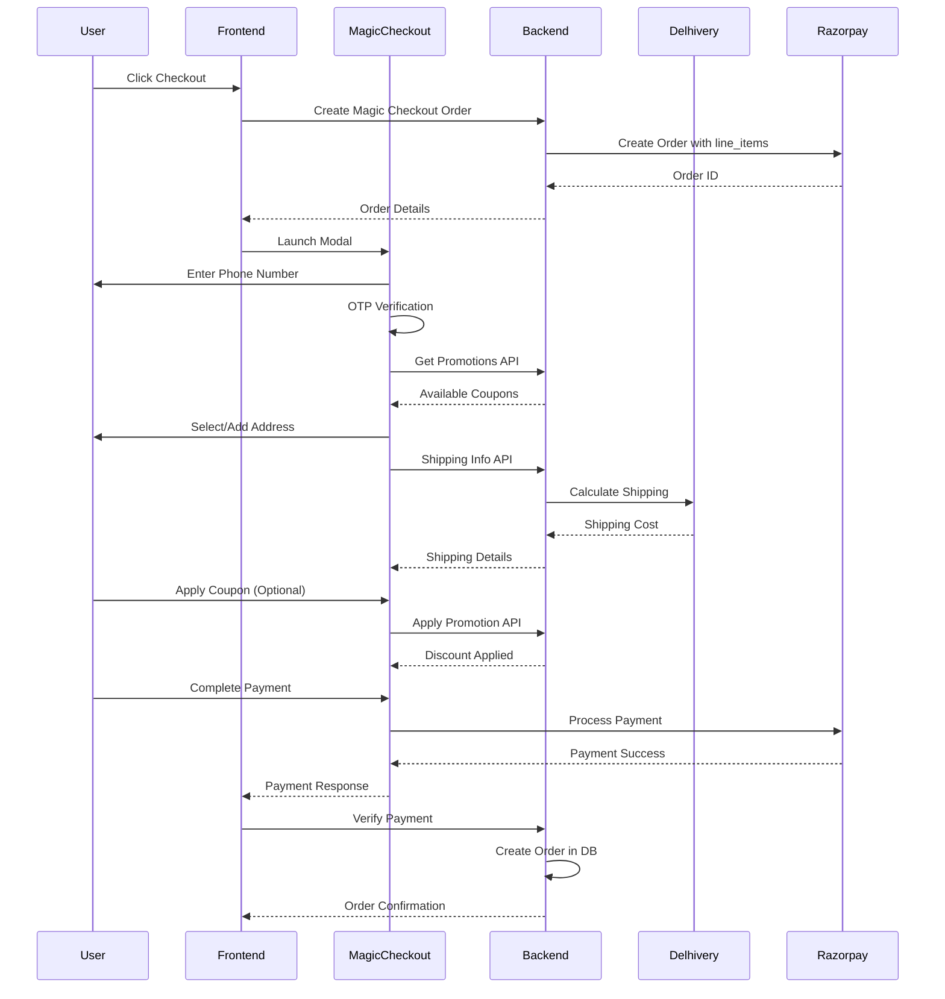

# Razorpay Magic Checkout Integration Guide

**Version:** 1.0  
**Date:** November 2025  
**Project:** amrti E-commerce Backend  
**Status:** Production Ready with Delhivery Connected

---

## Table of Contents
1. [Overview](#overview)
2. [Prerequisites](#prerequisites)
3. [Architecture Flow](#architecture-flow)
4. [Dashboard Configuration](#dashboard-configuration)
5. [Backend Implementation](#backend-implementation)
6. [Frontend Implementation](#frontend-implementation)
7. [Testing Guide](#testing-guide)
8. [Production Deployment](#production-deployment)
9. [Troubleshooting](#troubleshooting)

---

## Overview

Razorpay Magic Checkout is a one-page checkout solution that streamlines the entire checkout process. It handles:
- Phone number verification (OTP)
- Address collection and validation
- Dynamic shipping calculation via Delhivery
- Coupon application
- Payment processing

### Key Benefits
- **Faster checkout**: Single page, no redirects
- **Higher conversion**: 40% faster than traditional checkout
- **Built-in features**: Address management, coupon system
- **Seamless integration**: Works with existing Razorpay setup

---

## Prerequisites

### ✅ Already Completed
1. **Razorpay Account**: Active with production credentials
2. **Magic Checkout**: Enabled in Razorpay dashboard
3. **Delhivery Integration**: Connected and configured
4. **Firebase Auth**: Phone authentication setup
5. **Coupon System**: Active with validation APIs
6. **Cart System**: Session and authenticated cart support

### 🔧 Required Configuration
1. API endpoints for Magic Checkout
2. Frontend script update
3. Order creation modification

---

## Architecture Flow



---

## Dashboard Configuration

### 1. Access Magic Checkout Settings

1. Login to [Razorpay Dashboard](https://dashboard.razorpay.com)
2. Navigate to **Payment Products** → **Magic Checkout**
3. Click on **Checkout Settings**

### 2. Configure API Endpoints

In the **Checkout Settings** page, configure these URLs:

#### Shipping Setup
```
URL for shipping info: https://api.amrti.com/api/v1/magic-checkout/shipping-info
```

#### Coupon Settings
```
URL for get promotions: https://api.amrti.com/api/v1/magic-checkout/get-promotions
URL for apply promotions: https://api.amrti.com/api/v1/magic-checkout/apply-promotion
Auto fetch coupon: ✅ Enabled
```

### 3. Delivery Tracking (Already Connected)
- **Delhivery**: ✅ Connected
- Automatic delivery status updates enabled
- RTO Protection on COD orders enabled

---

## Backend Implementation

### 1. Create Magic Checkout Handler

Create new file: `internal/handlers/magic_checkout_handler.go`

```go
package handlers

import (
    "fmt"
    "strings"
    "github.com/gin-gonic/gin"
    "github.com/amrti/ecommerce-backend/internal/services"
    "github.com/amrti/ecommerce-backend/entities/requests"
    "go.uber.org/zap"
    "net/http"
)

type MagicCheckoutHandler struct {
    paymentService  *services.PaymentService
    couponService   *services.CouponService
    deliveryService *services.DeliveryService
    cartService     *services.CartService
    orderService    *services.OrderService
    logger          *zap.Logger
}

func NewMagicCheckoutHandler(
    paymentService *services.PaymentService,
    couponService *services.CouponService,
    deliveryService *services.DeliveryService,
    cartService *services.CartService,
    orderService *services.OrderService,
    logger *zap.Logger,
) *MagicCheckoutHandler {
    return &MagicCheckoutHandler{
        paymentService:  paymentService,
        couponService:   couponService,
        deliveryService: deliveryService,
        cartService:     cartService,
        orderService:    orderService,
        logger:          logger,
    }
}

// GetPromotions returns available coupons for Magic Checkout
// Endpoint: GET /api/v1/magic-checkout/get-promotions
func (h *MagicCheckoutHandler) GetPromotions(c *gin.Context) {
    // Magic Checkout sends these as body parameters in POST request
    var req struct {
        OrderID       string `json:"order_id"`
        RazorpayOrderID string `json:"razorpay_order_id"`
        Contact       string `json:"contact"`
        Email         string `json:"email"`
    }
    
    if err := c.ShouldBindJSON(&req); err != nil {
        h.logger.Error("Invalid get promotions request", zap.Error(err))
        c.JSON(http.StatusOK, gin.H{"promotions": []interface{}{}})
        return
    }
    
    h.logger.Info("Magic Checkout requesting promotions",
        zap.String("order_id", req.OrderID),
        zap.String("razorpay_order_id", req.RazorpayOrderID),
        zap.String("contact", req.Contact))
    
    // Get active coupons from existing service
    activeCoupons, err := h.couponService.GetActiveCoupons(c.Request.Context())
    if err != nil {
        h.logger.Error("Failed to get active coupons", zap.Error(err))
        c.JSON(http.StatusOK, gin.H{"promotions": []interface{}{}})
        return
    }
    
    // Format for Magic Checkout
    promotions := []map[string]interface{}{}
    
    if couponsData, ok := activeCoupons.Data.([]interface{}); ok {
        for _, coupon := range couponsData {
            if couponMap, ok := coupon.(map[string]interface{}); ok {
                // Get the first rule for display
                if rules, ok := couponMap["rules"].([]interface{}); ok && len(rules) > 0 {
                    if firstRule, ok := rules[0].(map[string]interface{}); ok {
                        
                        promotion := map[string]interface{}{
                            "code":        couponMap["code"],
                            "reference_id": couponMap["id"],
                            "description": couponMap["description"],
                        }
                        
                        // Determine type and value based on rule
                        if ruleType, ok := firstRule["type"].(string); ok {
                            if ruleType == "percentage" {
                                promotion["type"] = "percentage"
                                promotion["value"] = firstRule["discount_value"]
                            } else {
                                promotion["type"] = "cart_value"
                                // Convert to paise
                                if value, ok := firstRule["discount_value"].(float64); ok {
                                    promotion["value"] = int(value * 100)
                                }
                            }
                        }
                        
                        promotions = append(promotions, promotion)
                    }
                }
            }
        }
    }
    
    c.JSON(http.StatusOK, gin.H{
        "promotions": promotions,
    })
}

// ApplyPromotion validates and applies a coupon
// Endpoint: POST /api/v1/magic-checkout/apply-promotion
func (h *MagicCheckoutHandler) ApplyPromotion(c *gin.Context) {
    var req struct {
        OrderID         string `json:"order_id"`
        RazorpayOrderID string `json:"razorpay_order_id"`
        Contact         string `json:"contact"`
        Email           string `json:"email"`
        Code            string `json:"code"`
    }
    
    if err := c.ShouldBindJSON(&req); err != nil {
        h.logger.Error("Invalid apply promotion request", zap.Error(err))
        c.JSON(http.StatusBadRequest, gin.H{
            "error": gin.H{
                "code": "INVALID_REQUEST",
                "description": "Invalid request format",
            },
        })
        return
    }
    
    h.logger.Info("Magic Checkout applying promotion",
        zap.String("order_id", req.OrderID),
        zap.String("code", req.Code),
        zap.String("contact", req.Contact))
    
    // Get order amount from Razorpay order
    rzpOrder, err := h.paymentService.GetOrder(c.Request.Context(), req.RazorpayOrderID)
    if err != nil {
        h.logger.Error("Failed to get Razorpay order", zap.Error(err))
        c.JSON(http.StatusBadRequest, gin.H{
            "error": gin.H{
                "code": "INVALID_PROMOTION",
                "description": "Order not found",
            },
        })
        return
    }
    
    // Extract cart total from order notes
    cartTotal := float64(rzpOrder.Amount) / 100.0 // Convert from paise to rupees
    
    // For guest checkout, use phone as identifier
    userID := "guest_" + req.Contact
    if rzpOrder.Notes != nil {
        if uid, ok := rzpOrder.Notes["user_id"].(string); ok && uid != "" {
            userID = uid
        }
    }
    
    // Validate coupon using existing service
    validation, err := h.couponService.ValidateCoupon(
        c.Request.Context(),
        req.Code,
        cartTotal,
        userID,
    )
    
    if err != nil || !validation.Success {
        h.logger.Warn("Coupon validation failed",
            zap.String("code", req.Code),
            zap.Error(err))
        
        errorMsg := "Invalid or expired coupon"
        if validation != nil && validation.Message != "" {
            errorMsg = validation.Message
        }
        
        c.JSON(http.StatusBadRequest, gin.H{
            "error": gin.H{
                "code": "INVALID_PROMOTION",
                "description": errorMsg,
            },
        })
        return
    }
    
    // Extract discount from validation response
    validationData := validation.Data.(map[string]interface{})
    discount := validationData["discount"].(float64)
    coupon := validationData["coupon"].(map[string]interface{})
    bestRule := validationData["best_rule"].(map[string]interface{})
    
    // Format response for Magic Checkout
    promotion := map[string]interface{}{
        "code":        req.Code,
        "reference_id": coupon["id"],
        "description": coupon["description"],
    }
    
    // Set type and value based on rule type
    if ruleType, ok := bestRule["type"].(string); ok {
        if ruleType == "percentage" {
            promotion["type"] = "percentage"
            promotion["value"] = bestRule["discount_value"]
        } else {
            promotion["type"] = "cart_value"
            promotion["value"] = int(discount * 100) // Convert to paise
        }
    }
    
    c.JSON(http.StatusOK, gin.H{
        "promotion": promotion,
    })
}

// GetShippingInfo calculates shipping for given addresses
// Endpoint: POST /api/v1/magic-checkout/shipping-info
func (h *MagicCheckoutHandler) GetShippingInfo(c *gin.Context) {
    var req struct {
        OrderID         string `json:"order_id"`
        RazorpayOrderID string `json:"razorpay_order_id"`
        Email           string `json:"email"`
        Contact         string `json:"contact"`
        Addresses       []struct {
            ID          string `json:"id"`
            Zipcode     string `json:"zipcode"`
            StateCode   string `json:"state_code"`
            Country     string `json:"country"`
            City        string `json:"city,omitempty"`
            State       string `json:"state,omitempty"`
            AddressLine1 string `json:"address_line_1,omitempty"`
            AddressLine2 string `json:"address_line_2,omitempty"`
        } `json:"addresses"`
    }
    
    if err := c.ShouldBindJSON(&req); err != nil {
        h.logger.Error("Invalid shipping info request", zap.Error(err))
        c.JSON(http.StatusBadRequest, gin.H{
            "addresses": []interface{}{},
        })
        return
    }
    
    h.logger.Info("Magic Checkout requesting shipping info",
        zap.String("order_id", req.OrderID),
        zap.String("razorpay_order_id", req.RazorpayOrderID),
        zap.Int("address_count", len(req.Addresses)))
    
    // Get order details to determine weight and cart total
    var weight int = 500 // Default 500g
    var cartTotal float64 = 0
    
    if req.RazorpayOrderID != "" {
        rzpOrder, err := h.paymentService.GetOrder(c.Request.Context(), req.RazorpayOrderID)
        if err == nil && rzpOrder.Notes != nil {
            // Get item count from notes
            if itemCount, ok := rzpOrder.Notes["total_items"].(float64); ok {
                weight = int(itemCount) * 100 // 100g per item
            }
            // Get cart total for free delivery check
            if total, ok := rzpOrder.Notes["cart_total"].(float64); ok {
                cartTotal = total
            }
        }
    }
    
    // Process each address
    result := []map[string]interface{}{}
    
    for _, addr := range req.Addresses {
        h.logger.Info("Processing address",
            zap.String("id", addr.ID),
            zap.String("zipcode", addr.Zipcode),
            zap.String("state", addr.StateCode))
        
        // Check serviceability via Delhivery
        serviceable, err := h.deliveryService.CheckServiceability(
            c.Request.Context(),
            addr.Zipcode,
        )
        
        addressResult := map[string]interface{}{
            "id": addr.ID,
            "serviceable": serviceable,
            "cod": serviceable, // COD available if serviceable
            "shipping_fee": 0,
            "cod_fee": 0,
        }
        
        if err != nil {
            h.logger.Warn("Serviceability check failed",
                zap.String("zipcode", addr.Zipcode),
                zap.Error(err))
            addressResult["serviceable"] = false
        } else if serviceable {
            // Calculate shipping charges
            charges, err := h.deliveryService.GetShippingCharges(
                c.Request.Context(),
                addr.Zipcode,
                weight,
                0, // No COD amount for shipping calculation
            )
            
            if err != nil {
                h.logger.Error("Failed to calculate shipping", zap.Error(err))
                // Use fallback shipping rate
                charges = 40.0
            }
            
            // Check for free delivery (cart total >= 500)
            if cartTotal >= 500 {
                h.logger.Info("Free delivery applied",
                    zap.Float64("cart_total", cartTotal))
                charges = 0
            }
            
            // Convert to paise
            addressResult["shipping_fee"] = int(charges * 100)
            
            // COD fee (₹20 if COD selected)
            if serviceable {
                addressResult["cod_fee"] = 2000 // ₹20 in paise
            }
        }
        
        result = append(result, addressResult)
    }
    
    c.JSON(http.StatusOK, gin.H{
        "addresses": result,
    })
}
```

### 2. Update Payment Handler

Add this method to `internal/handlers/payment_handler.go`:

```go
// CreateMagicCheckoutOrder creates a Razorpay order specifically for Magic Checkout
// @Summary Create Magic Checkout order
// @Description Create a Razorpay order with line items for Magic Checkout
// @Tags Payments
// @Accept json
// @Produce json
// @Security FirebaseAuth optional
// @Success 200 {object} map[string]interface{} "Magic Checkout order created"
// @Failure 400 {object} map[string]interface{} "Bad request"
// @Failure 500 {object} map[string]interface{} "Internal server error"
// @Router /payments/magic-checkout/create-order [post]
func (h *PaymentHandler) CreateMagicCheckoutOrder(c *gin.Context) {
    // Support both authenticated and guest checkout
    userID, authenticated := h.authContext.GetAuthenticatedUserID(c)
    
    if !authenticated {
        // For guest checkout, use session ID
        sessionID := c.GetHeader("X-Session-ID")
        if sessionID == "" {
            c.JSON(http.StatusBadRequest, gin.H{
                "error": "Please login or provide session ID for guest checkout",
            })
            return
        }
        userID = "session_" + sessionID
    }
    
    h.logger.Info("Creating Magic Checkout order",
        zap.String("user_id", userID),
        zap.Bool("authenticated", authenticated))
    
    // Get cart (supports both authenticated and session carts)
    var cart *models.Cart
    var err error
    
    if strings.HasPrefix(userID, "session_") {
        // Session cart
        sessionID := strings.TrimPrefix(userID, "session_")
        cart, err = h.cartService.GetSessionCart(c.Request.Context(), sessionID)
    } else {
        // User cart
        cart, err = h.cartService.GetUserCart(c.Request.Context(), userID)
    }
    
    if err != nil || cart == nil || len(cart.Items) == 0 {
        h.logger.Warn("Cart is empty or not found",
            zap.String("user_id", userID),
            zap.Error(err))
        c.JSON(http.StatusBadRequest, gin.H{
            "error": "Cart is empty. Please add items to cart.",
        })
        return
    }
    
    // Calculate totals
    cartTotal := cart.GetTotalAmount()
    discountedTotal := utils.ApplyDiscount(cartTotal, cart.DiscountAmount)
    
    // Prepare line items for Magic Checkout
    lineItems := []map[string]interface{}{}
    lineItemsTotal := 0
    
    for _, item := range cart.Items {
        // Get product details for better display
        product, _ := h.productService.GetProductByID(c.Request.Context(), item.ProductID)
        
        itemTotal := int(item.UnitPrice * float64(item.Quantity) * 100) // Convert to paise
        lineItemsTotal += itemTotal
        
        lineItem := map[string]interface{}{
            "sku":         item.ProductID,
            "name":        item.ProductName,
            "price":       int(item.UnitPrice * 100), // in paise
            "offer_price": int(item.UnitPrice * 100), // same as price for now
            "tax_amount":  0,
            "quantity":    item.Quantity,
            "description": "",
            "image_url":   "",
            "product_url": fmt.Sprintf("https://amrti.com/products/%s", item.ProductID),
            "weight":      100, // 100g per item (default)
            "dimensions": map[string]int{
                "length": 10,
                "width":  10,
                "height": 10,
            },
            "variant_id": item.ProductID,
        }
        
        // Add product details if available
        if product != nil {
            if desc, ok := product["description"].(string); ok {
                lineItem["description"] = desc
            }
            if images, ok := product["images"].([]interface{}); ok && len(images) > 0 {
                if firstImage, ok := images[0].(map[string]interface{}); ok {
                    if url, ok := firstImage["url"].(string); ok {
                        lineItem["image_url"] = url
                    }
                }
            }
        }
        
        lineItems = append(lineItems, lineItem)
    }
    
    // Prepare notes for order tracking
    notes := map[string]interface{}{
        "user_id":        userID,
        "cart_total":     cartTotal,
        "discount":       cart.DiscountAmount,
        "coupon_code":    cart.CouponCode,
        "total_items":    len(cart.Items),
        "magic_checkout": true,
        "authenticated":  authenticated,
    }
    
    // Add user details if authenticated
    if authenticated && !strings.HasPrefix(userID, "session_") {
        user, err := h.userService.GetUserByID(c.Request.Context(), userID)
        if err == nil && user != nil {
            if userData, ok := user.Data.(map[string]interface{}); ok {
                notes["customer_name"] = userData["name"]
                notes["customer_phone"] = userData["phone_number"]
                notes["customer_email"] = userData["email"]
            }
        }
    }
    
    // Create Razorpay order with line items
    orderOptions := map[string]interface{}{
        "amount":           int(discountedTotal * 100), // Convert to paise
        "currency":         "INR",
        "receipt":          fmt.Sprintf("magic_%s_%d", userID, time.Now().Unix()),
        "notes":            notes,
        "line_items_total": lineItemsTotal,
        "line_items":       lineItems,
    }
    
    razorpayOrder, err := h.paymentService.CreateOrderWithOptions(
        c.Request.Context(),
        orderOptions,
    )
    
    if err != nil {
        h.logger.Error("Failed to create Razorpay order",
            zap.Error(err),
            zap.String("user_id", userID))
        c.JSON(http.StatusInternalServerError, gin.H{
            "error": "Failed to create payment order. Please try again.",
        })
        return
    }
    
    // Prepare response
    cfg := config.GetRazorpayConfig()
    response := gin.H{
        "order_id": razorpayOrder.ID,
        "amount":   services.PaisaToRupees(razorpayOrder.Amount),
        "currency": "INR",
        "key_id":   cfg.KeyID,
        "receipt":  razorpayOrder.Receipt,
    }
    
    // Add prefill data if available
    if notes["customer_phone"] != nil || notes["customer_email"] != nil {
        prefill := gin.H{}
        if phone, ok := notes["customer_phone"].(string); ok && phone != "" {
            prefill["contact"] = phone
        }
        if email, ok := notes["customer_email"].(string); ok && email != "" {
            prefill["email"] = email
        }
        if name, ok := notes["customer_name"].(string); ok && name != "" {
            prefill["name"] = name
        }
        
        if len(prefill) > 0 {
            response["prefill"] = prefill
        }
    }
    
    h.logger.Info("Magic Checkout order created successfully",
        zap.String("razorpay_order_id", razorpayOrder.ID),
        zap.String("user_id", userID),
        zap.Float64("amount", discountedTotal),
        zap.Int("line_items", len(lineItems)))
    
    c.JSON(http.StatusOK, response)
}
```

### 3. Add Routes

Update `internal/routes/payment/payment_routes.go`:

```go
// Add Magic Checkout routes
magicCheckout := r.Group("/magic-checkout")
{
    // These endpoints are called by Razorpay Magic Checkout
    // They must be publicly accessible (no auth middleware)
    magicCheckout.POST("/get-promotions", magicCheckoutHandler.GetPromotions)
    magicCheckout.POST("/apply-promotion", magicCheckoutHandler.ApplyPromotion)
    magicCheckout.POST("/shipping-info", magicCheckoutHandler.GetShippingInfo)
}

// Add authenticated endpoint for creating Magic Checkout order
// This can be called by both authenticated users and guests with session ID
payments.POST("/magic-checkout/create-order", paymentHandler.CreateMagicCheckoutOrder)
```

### 4. Update Service Manager

In `internal/services/service_manager.go`, initialize the Magic Checkout handler:

```go
// In your route initialization function
magicCheckoutHandler := handlers.NewMagicCheckoutHandler(
    paymentService,
    couponService,
    deliveryService,
    cartService,
    orderService,
    logger,
)
```

---

## Frontend Implementation

### 1. Update Checkout Script

Replace the standard Razorpay script with Magic Checkout script:

```html
<!-- OLD -->
<script src="https://checkout.razorpay.com/v1/checkout.js"></script>

<!-- NEW -->
<script src="https://checkout.razorpay.com/v1/magic-checkout.js"></script>
```

### 2. Implement Checkout Flow

```javascript
// checkout.js
class MagicCheckout {
    constructor(config) {
        this.apiBase = config.apiBase || '/api/v1';
        this.authToken = config.authToken;
        this.sessionId = config.sessionId;
    }
    
    async initiateCheckout() {
        try {
            // Step 1: Create Magic Checkout order
            const orderResponse = await this.createOrder();
            
            if (!orderResponse.success) {
                throw new Error(orderResponse.error || 'Failed to create order');
            }
            
            // Step 2: Configure Magic Checkout options
            const options = {
                key: orderResponse.data.key_id,
                order_id: orderResponse.data.order_id,
                
                // Enable Magic Checkout
                one_click_checkout: true,
                show_coupons: true,
                
                // Optional prefill data
                prefill: orderResponse.data.prefill || {},
                
                // Callback handlers
                handler: async (response) => {
                    // Payment successful - verify on backend
                    await this.verifyPayment(response);
                },
                
                modal: {
                    ondismiss: () => {
                        console.log('Checkout cancelled by user');
                        this.onCheckoutCancelled();
                    }
                },
                
                // Theme customization
                theme: {
                    color: '#3399cc'
                },
                
                // Additional options
                retry: {
                    enabled: true,
                    max_count: 3
                }
            };
            
            // Step 3: Open Magic Checkout
            const rzp = new Razorpay(options);
            rzp.open();
            
        } catch (error) {
            console.error('Checkout failed:', error);
            this.showError(error.message);
        }
    }
    
    async createOrder() {
        const headers = {
            'Content-Type': 'application/json'
        };
        
        // Add auth header if logged in
        if (this.authToken) {
            headers['Authorization'] = `Bearer ${this.authToken}`;
        } else if (this.sessionId) {
            // For guest checkout
            headers['X-Session-ID'] = this.sessionId;
        }
        
        const response = await fetch(`${this.apiBase}/payments/magic-checkout/create-order`, {
            method: 'POST',
            headers: headers
        });
        
        const data = await response.json();
        
        if (!response.ok) {
            return { success: false, error: data.error };
        }
        
        return { success: true, data: data };
    }
    
    async verifyPayment(paymentResponse) {
        try {
            const response = await fetch(`${this.apiBase}/payments/verify`, {
                method: 'POST',
                headers: {
                    'Content-Type': 'application/json',
                    'Authorization': this.authToken ? `Bearer ${this.authToken}` : undefined
                },
                body: JSON.stringify({
                    razorpay_order_id: paymentResponse.razorpay_order_id,
                    razorpay_payment_id: paymentResponse.razorpay_payment_id,
                    razorpay_signature: paymentResponse.razorpay_signature
                })
            });
            
            const result = await response.json();
            
            if (result.success) {
                // Clear cart and redirect to success page
                this.onPaymentSuccess(result);
            } else {
                throw new Error(result.message || 'Payment verification failed');
            }
        } catch (error) {
            console.error('Payment verification failed:', error);
            this.showError('Payment verification failed. Please contact support.');
        }
    }
    
    onPaymentSuccess(result) {
        // Clear local cart
        localStorage.removeItem('cart');
        
        // Redirect to success page
        window.location.href = `/order-success/${result.order_id}?payment_id=${result.payment_id}`;
    }
    
    onCheckoutCancelled() {
        // Optional: Track abandonment
        console.log('Checkout abandoned');
    }
    
    showError(message) {
        // Show error to user
        alert(message);
    }
}

// Initialize and use
document.addEventListener('DOMContentLoaded', () => {
    const checkoutBtn = document.getElementById('checkout-btn');
    
    checkoutBtn.addEventListener('click', () => {
        const checkout = new MagicCheckout({
            apiBase: 'https://api.amrti.com/api/v1',
            authToken: localStorage.getItem('auth_token'),
            sessionId: localStorage.getItem('session_id')
        });
        
        checkout.initiateCheckout();
    });
});
```

### 3. React/Vue Integration Example

```jsx
// React component
import React, { useState } from 'react';

const CheckoutButton = ({ cart, user }) => {
    const [loading, setLoading] = useState(false);
    
    const handleCheckout = async () => {
        setLoading(true);
        
        try {
            // Create order
            const response = await fetch('/api/v1/payments/magic-checkout/create-order', {
                method: 'POST',
                headers: {
                    'Content-Type': 'application/json',
                    'Authorization': user?.token ? `Bearer ${user.token}` : undefined,
                    'X-Session-ID': !user ? sessionStorage.getItem('session_id') : undefined
                }
            });
            
            const orderData = await response.json();
            
            // Configure Razorpay
            const options = {
                key: orderData.key_id,
                order_id: orderData.order_id,
                one_click_checkout: true,
                show_coupons: true,
                prefill: orderData.prefill || {},
                handler: async (response) => {
                    await verifyPayment(response);
                },
                theme: {
                    color: '#3399cc'
                }
            };
            
            // Open Magic Checkout
            const rzp = new window.Razorpay(options);
            rzp.open();
            
        } catch (error) {
            console.error('Checkout failed:', error);
            alert('Checkout failed. Please try again.');
        } finally {
            setLoading(false);
        }
    };
    
    const verifyPayment = async (paymentResponse) => {
        // Implement payment verification
        const response = await fetch('/api/v1/payments/verify', {
            method: 'POST',
            headers: {
                'Content-Type': 'application/json',
                'Authorization': user?.token ? `Bearer ${user.token}` : undefined
            },
            body: JSON.stringify(paymentResponse)
        });
        
        const result = await response.json();
        
        if (result.success) {
            window.location.href = `/order-success/${result.order_id}`;
        } else {
            alert('Payment verification failed');
        }
    };
    
    return (
        <button 
            onClick={handleCheckout}
            disabled={loading || cart.items.length === 0}
            className="checkout-btn"
        >
            {loading ? 'Processing...' : 'Checkout with Razorpay'}
        </button>
    );
};
```

---

## Testing Guide

### 1. Test Environment Setup

1. **Use Test Mode**: Switch to test mode in Razorpay Dashboard
2. **Configure Test URLs**: Update Magic Checkout URLs to your staging environment
3. **Test Credentials**: Use test API keys

### 2. Test Scenarios

#### Scenario 1: Guest Checkout
```
1. Add items to cart without login
2. Click checkout
3. Enter phone number in Magic Checkout
4. Verify OTP (test mode auto-fills)
5. Add new address
6. Check shipping calculation
7. Apply coupon code
8. Complete payment with test card
```

#### Scenario 2: Authenticated Checkout
```
1. Login with existing user
2. Add items to cart
3. Click checkout
4. Magic Checkout should prefill phone/email
5. Select saved address
6. Verify free delivery for orders > ₹500
7. Complete payment
```

#### Scenario 3: Edge Cases
```
1. Non-serviceable pincode (should show error)
2. Invalid coupon code
3. Expired coupon
4. Payment failure
5. Network timeout
```

### 3. Test Cards

```
Success: 4111 1111 1111 1111
CVV: Any 3 digits
Expiry: Any future date

Failure: 4111 1111 1111 1234
```

### 4. Debugging

Check these endpoints in browser DevTools Network tab:
- `/api/v1/magic-checkout/shipping-info` - Should return shipping costs
- `/api/v1/magic-checkout/get-promotions` - Should return available coupons
- `/api/v1/magic-checkout/apply-promotion` - Should validate coupon

---

## Production Deployment

### 1. Pre-deployment Checklist

- [ ] All API endpoints tested in staging
- [ ] Response time < 3 seconds for all endpoints
- [ ] HTTPS enabled on all endpoints
- [ ] Error handling implemented
- [ ] Logging configured
- [ ] Rate limiting in place
- [ ] CORS configured correctly

### 2. Configuration Steps

1. **Update Dashboard URLs** to production:
   ```
   https://api.amrti.com/api/v1/magic-checkout/shipping-info
   https://api.amrti.com/api/v1/magic-checkout/get-promotions
   https://api.amrti.com/api/v1/magic-checkout/apply-promotion
   ```

2. **Environment Variables**:
   ```bash
   RAZORPAY_KEY_ID=your_live_key_id
   RAZORPAY_KEY_SECRET=your_live_key_secret
   RAZORPAY_WEBHOOK_SECRET=your_webhook_secret
   ```

3. **Update Frontend**:
   - Change script to magic-checkout.js
   - Add one_click_checkout: true
   - Update API endpoints to production

### 3. Monitoring

Monitor these metrics:
- API response times
- Payment success rate
- Coupon usage
- Shipping calculation accuracy
- Error rates

---

## Troubleshooting

### Issue: Standard Checkout Shows Instead of Magic

**Cause**: Missing `line_items_total` in order creation

**Fix**: Ensure order creation includes:
```go
orderOptions := map[string]interface{}{
    "amount": totalAmount,
    "currency": "INR",
    "line_items_total": lineItemsTotal, // REQUIRED
    "line_items": lineItems,            // REQUIRED
}
```

### Issue: Shipping Not Calculating

**Check**:
1. Delhivery API token is valid
2. Pincode format is correct (6 digits)
3. Response format matches expected structure
4. Free delivery logic (₹500+) is working

### Issue: Coupons Not Showing

**Check**:
1. `/get-promotions` returning correct format
2. Active coupons exist in database
3. Response includes all required fields
4. `show_coupons: true` in frontend

### Issue: Payment Verification Failing

**Check**:
1. Signature verification logic
2. Order creation in database
3. Cart clearing after success
4. User account linking (for guest checkout)

---

## API Reference

### Magic Checkout APIs (Called by Razorpay)

#### 1. Get Promotions
```
POST /api/v1/magic-checkout/get-promotions
Content-Type: application/json

Request:
{
  "order_id": "receipt_123",
  "razorpay_order_id": "order_abc",
  "contact": "+919876543210",
  "email": "user@example.com"
}

Response:
{
  "promotions": [
    {
      "code": "SAVE100",
      "value": 10000,
      "type": "cart_value",
      "description": "Get ₹100 off",
      "reference_id": "promo_1"
    }
  ]
}
```

#### 2. Apply Promotion
```
POST /api/v1/magic-checkout/apply-promotion
Content-Type: application/json

Request:
{
  "order_id": "receipt_123",
  "razorpay_order_id": "order_abc",
  "contact": "+919876543210",
  "email": "user@example.com",
  "code": "SAVE100"
}

Success Response:
{
  "promotion": {
    "code": "SAVE100",
    "value": 10000,
    "type": "cart_value",
    "description": "Get ₹100 off",
    "reference_id": "promo_1"
  }
}

Error Response:
{
  "error": {
    "code": "INVALID_PROMOTION",
    "description": "Coupon code is invalid or expired"
  }
}
```

#### 3. Shipping Info
```
POST /api/v1/magic-checkout/shipping-info
Content-Type: application/json

Request:
{
  "order_id": "receipt_123",
  "razorpay_order_id": "order_abc",
  "email": "user@example.com",
  "contact": "+919876543210",
  "addresses": [
    {
      "id": "0",
      "zipcode": "560001",
      "state_code": "KA",
      "country": "IN"
    }
  ]
}

Response:
{
  "addresses": [
    {
      "id": "0",
      "serviceable": true,
      "cod": true,
      "shipping_fee": 5000,
      "cod_fee": 2000
    }
  ]
}
```

---

## Summary

Magic Checkout integration provides a seamless, one-page checkout experience that significantly improves conversion rates. The integration leverages your existing infrastructure:

- **Existing APIs**: Coupon validation and shipping calculation
- **Delhivery Integration**: Real-time shipping costs
- **Firebase Auth**: User management
- **Payment Flow**: Standard Razorpay payment verification

Key benefits:
- 40% faster checkout
- Built-in address management
- Dynamic shipping calculation
- Integrated coupon system
- Support for guest checkout

For support:
- Razorpay: support@razorpay.com
- Technical issues: Check dashboard logs
- Integration help: Refer to this guide

---

**Document Version**: 1.0
**Last Updated**: November 2025
**Maintained by**: amrti Development Team
